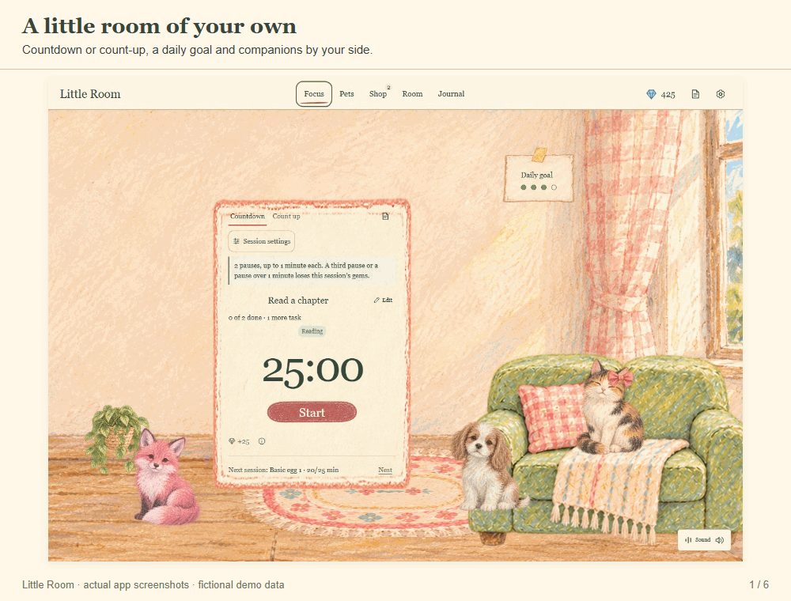
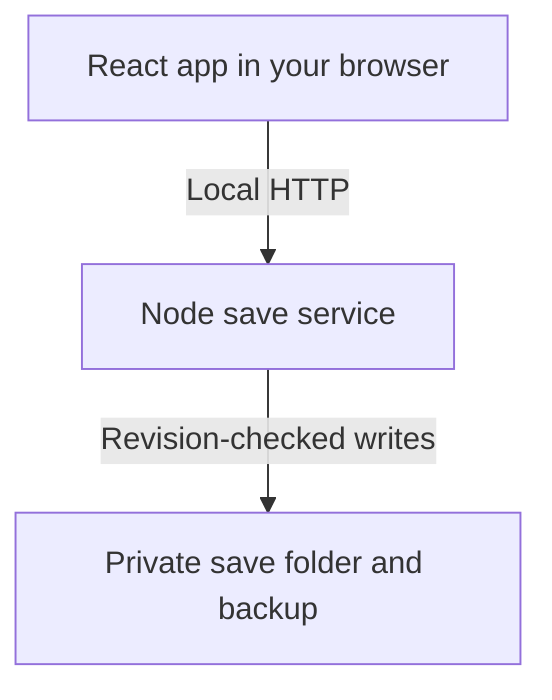

# Little Room

**A gentler Pomodoro.** Focus in an illustrated room, collect animal companions,
and make a little space of your own.

Little Room is a local-first React app with a Node.js save service. It runs on
your computer and saves progress to disk, without an account or cloud sync.


*Actual app, fictional demo room.* [Screenshots and walkthrough](docs/SHOWCASE.md)
· [Download the captioned demo](docs/media/walkthrough.webm) (39 seconds, WebM).

<details>
<summary>See the animated feature preview (21 seconds)</summary>



The [static gallery and walkthrough transcript](docs/SHOWCASE.md) cover the same
features without animation.

</details>

## What you can do

- **Focus:** countdown or count-up, tasks and tags, pause/resume, overtime, and
  short or long breaks.
- **Grow a collection:** earn Shilligems through focus, hatch eggs, and unlock
  pet upgrades, animations and accessories.
- **Arrange your room:** choose illustrated room styles and place furniture,
  pets, the timer and your daily goal.
- **Keep context:** jot notes in the Scratchpad and review sessions, activity
  charts and tag totals in the Journal.
- **Set the atmosphere:** mix ambient sounds, adjust interaction audio, and
  choose reduced motion.

Shilligems are in-app points; there are no real-money purchases.
The [user guide](docs/USER_GUIDE.md) explains the controls and reward rules.

## Quick start

Use **Node.js 22 or 24 LTS**. [.nvmrc](.nvmrc) pins the tested 22.23.3 baseline.

```sh
npm ci
npm start
```

Open the **Little Room app** address printed in the terminal, usually
**http://127.0.0.1:3000**. This starts the browser app and save service together.
Development startup advances past occupied ports. Keep the terminal open;
press **Ctrl+C** to stop both services.

To run the production build locally:

```sh
npm run build:check
npm run serve
```

Open the printed address, usually **http://127.0.0.1:3001**. The Node service
serves both the built app and its save API. A static-only host cannot provide
the disk-save service. Development and production use the same default save
folder; see [setup and local saves](docs/SETUP.md) for separate profiles, port
overrides, backup and troubleshooting.

## Your progress stays on your computer

The timer, collection, room, tasks, notes and history are saved outside this
repository. The service keeps a recovery backup and checks revisions to catch
competing edits from another window. Save problems preserve edits in memory
and offer a reference-only recovery draft; drafts cannot be imported or merged
automatically. [Learn how to back up or recover progress](docs/SETUP.md#backup-and-recovery).



See [architecture](docs/ARCHITECTURE.md) for deployment, state ownership and the
save lifecycle.

## Explore the project

| For | Start here |
| --- | --- |
| Using the app | [User guide](docs/USER_GUIDE.md) |
| Seeing the main features | [Screenshots and walkthrough](docs/SHOWCASE.md) |
| Installing, running and protecting saves | [Setup](docs/SETUP.md) |
| Finding the implementation | [Source map](docs/SOURCE_MAP.md) |
| Understanding how it works | [Architecture and diagrams](docs/ARCHITECTURE.md) |
| Making a change | [Contributor guide](CONTRIBUTING.md) |
| Running checks and understanding CI | [Automated validation](docs/AUTOMATION.md) |
| Current scope, evidence and historical context | [Documentation index](docs/README.md) |

For the core checks after installing dependencies:

```sh
npm run check
```

For the full suite, first run `npm run browsers:install`, then `npm run validate`.
The separate `npm run audit:dependencies` gate uses documented, expiring
[CRA tooling exceptions](docs/DEPENDENCIES.md); passing it does not mean zero
advisories.

## Release status

Version **0.1.0** is being prepared for an initial local desktop release.
Windows clean-install validation and headless Chromium, Firefox and WebKit
checks are recorded. Hosted CI, hands-on accessibility/audio checks and broader
device acceptance remain open. See the [support scope](docs/PROJECT.md#support-claims)
and [release quality record](docs/RELEASE_QUALITY.md) for the exact boundaries.

## License and artwork

Project code and documentation use the [MIT license](LICENSE). Artwork rights
are recorded separately in [ASSET_RIGHTS.md](ASSET_RIGHTS.md) and
[ARTWORK.md](docs/ARTWORK.md); the code license does not relicense those assets.
Dependency notices are in [THIRD_PARTY_NOTICES.md](THIRD_PARTY_NOTICES.md).
