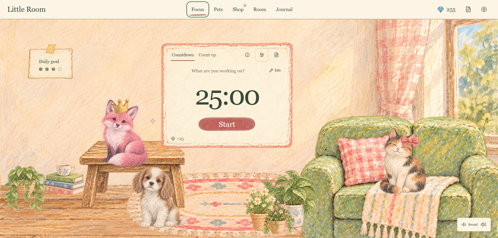
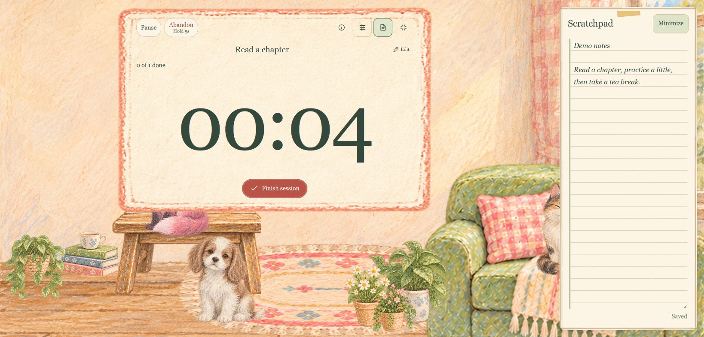
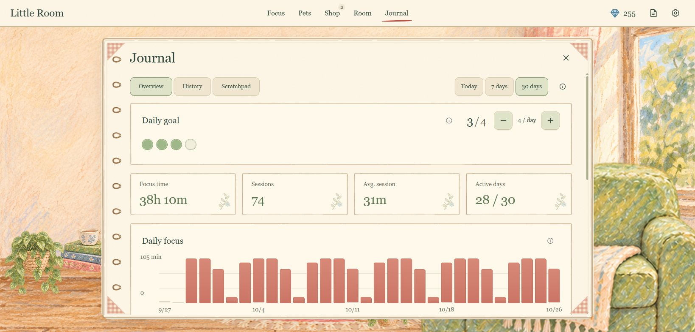
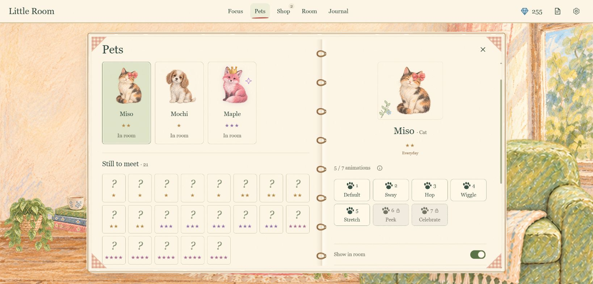
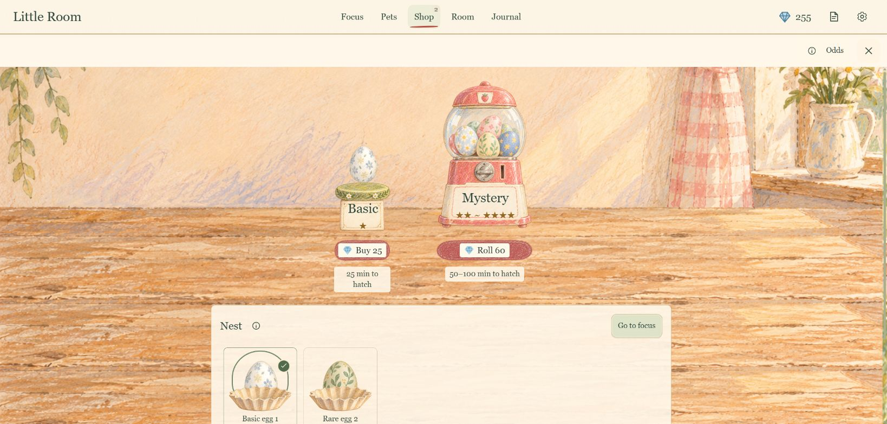

# Little Room

**A gentler Pomodoro.** Focus in an illustrated room, collect animal companions,
and make a little space of your own.



## What it does

- Countdown or count up, with tasks, tags and automatic breaks.
- Earn Shilligems through focus, hatch pets and unlock accessories.
- Arrange furniture, companions, the timer and your daily goal.
- Keep a Scratchpad and review focus history and charts in the Journal.
- Mix rain, fireplace and brown noise, with separate sound and motion controls.

Shilligems are in-app points; there are no real-money purchases.

## Screenshots

| Focus and notes | Journal |
| --- | --- |
|  |  |
| **Pets** | **Egg shop** |
|  |  |

Actual app screenshots using fictional demo progress and a custom room layout.
A fresh installation starts with its own starter room.

## Quick start

Install **Node.js 22 or 24 LTS**, then run:

```sh
git clone https://github.com/IAmJennyZhao/PomodoroTimer.git
cd PomodoroTimer
npm ci
npm start
```

Open the printed app URL, usually **http://127.0.0.1:3000**. Keep the terminal
running while using the app; **Ctrl+C** stops it.

For populated charts, pets and eggs, use `npm run demo` instead of `npm start`.
It normally runs at **http://127.0.0.1:3002**, with a fresh temporary profile
each launch. Your ordinary saves are separate.

## Built with

React 18, JavaScript and CSS power the interface. A central reducer handles
timer and collection rules; a Node.js HTTP service saves progress to local JSON
files with revision checks and a recovery backup. Charts use saved session
history, and Web Audio synthesizes the sounds.

Little Room runs on your computer without an account, database or cloud sync.
It needs the local Node service; a static-only host cannot provide saving.
Desktop use is the current target. The initial v0.1.0 release is being prepared;
hands-on audio and accessibility acceptance is still pending.

## Documentation

- [How to run](docs/SETUP.md) — setup, demo mode, production and local saves.
- [Technical guide](docs/ARCHITECTURE.md) — architecture, state, persistence and checks.

## License and artwork

Code and documentation use the [MIT license](LICENSE). The illustrated artwork
is generated and has [separate terms](ASSET_RIGHTS.md#limited-artwork-permission):
you may run Little Room and share screenshots; other artwork reuse is reserved.
See [third-party notices](THIRD_PARTY_NOTICES.md) for dependency attribution.
