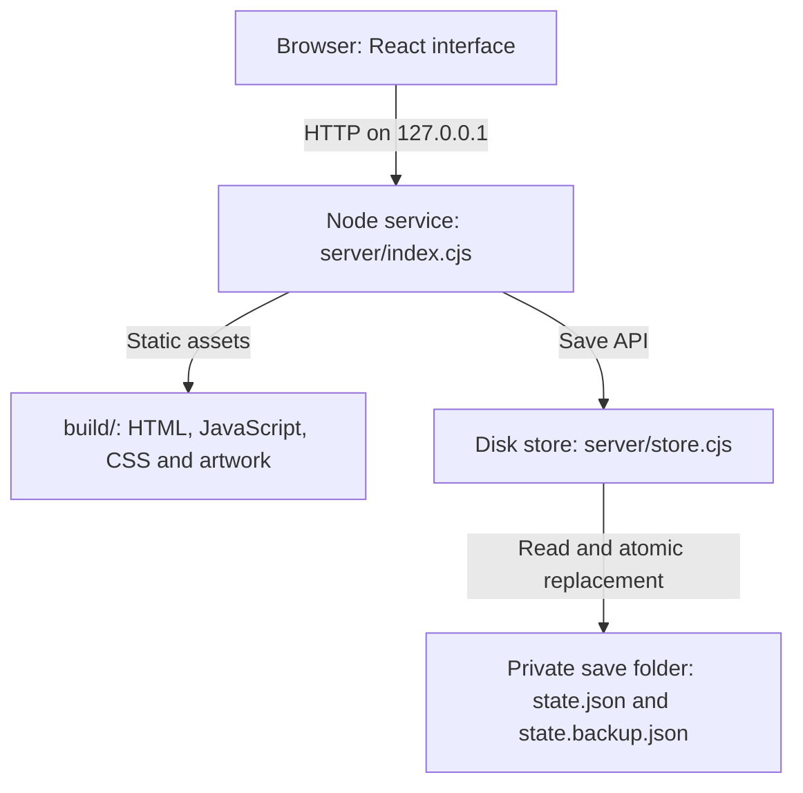
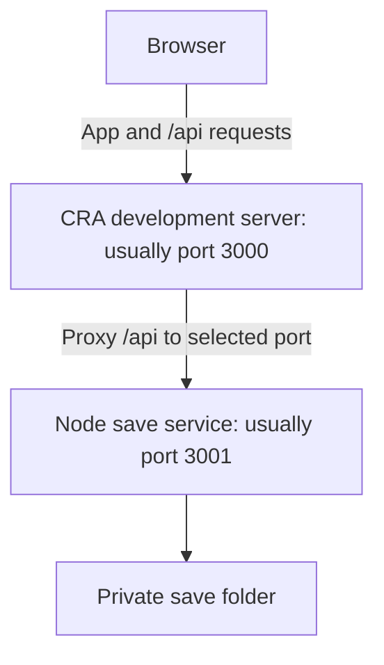
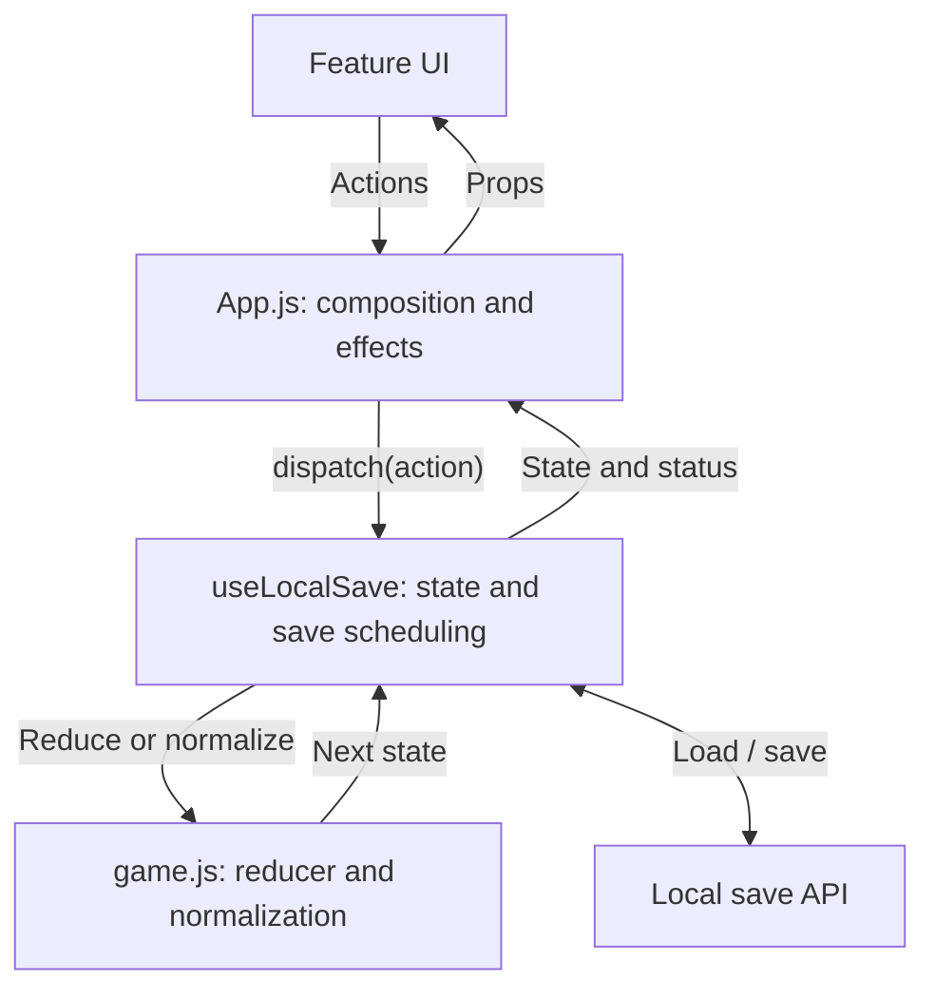
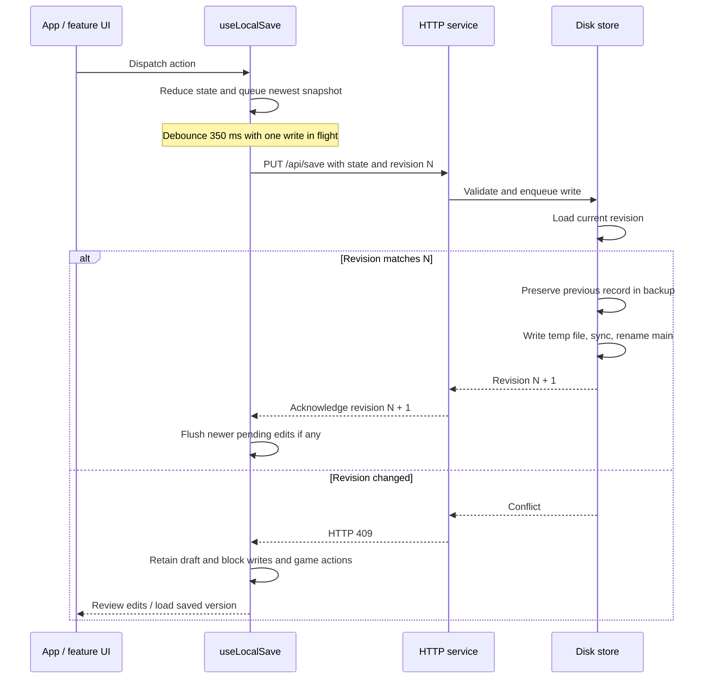

# Architecture

Little Room has a React browser interface, a central game reducer, and a local
Node.js HTTP/filesystem service. It has no database, account system or cloud sync.
This page describes the current implementation; the
[source map](SOURCE_MAP.md) identifies the files and tests for a specific change.

## Local deployment

In production, the service serves both `build/` and `/api/save` on one loopback
port. The save folder is outside the repository and build output.

Development uses two distinct loopback ports. [dev.cjs](../scripts/dev.cjs)
chooses available ports, starts the API, then starts CRA with the selected proxy
target. [start-react.cjs](../scripts/start-react.cjs) configures CRA startup.

The HTTP service checks Host/Origin and listens locally. Its production static
handler resolves assets within the build root and supports extensionless SPA
routes. The store rejects repository-contained data directories and unsafe
save-file links. This deployment is designed for one local service per profile;
it does not provide authentication for a public network deployment.

## Application and state ownership

[App.js](../src/App.js) imports feature panels directly and composes the room,
timer, workspaces and shared feedback. `useLocalSave` calls `gameReducer` and
publishes current game state. Components receive state and callbacks; they do
not access disk or implement their own reward accounting.

The app supplies current time and purchase/hatch rolls in actions, derives
Journal summaries through `analytics.js`, and drives the Web Audio engine from
settings and timer feedback.

| State | Owner and lifetime |
| --- | --- |
| Timer, settings, balance, pets, eggs, ownership, room placements, notes, history and mystery-roll pity | Domain state managed by `useLocalSave`; persisted to disk |
| Open panel, selection, quiet focus view, hatch presentation, notices and alarm mute for this visit | React state/effects in the app and feature hooks; transient |
| Pending snapshot, acknowledged revision, write in flight and recovery drafts | Persistence hook; retained in this window, with explicit draft download |
| Journal totals and charts | Derived from saved history by `domain/analytics.js` |
| Audio context, synthesized sounds and active playback | `audio/engine.js`; settings persisted, playback transient |

`event` communicates a domain outcome to the current UI. Persistence sets it
to `null` in snapshots so restoring a save does not replay that notification.
Reduced motion combines the saved preference with the system preference.
Animations and audio report accepted actions; their completion is not required
for rewards, saving or navigation.

## Timer and progression

[game.js](../src/domain/game.js) owns countdown/count-up rules, pause limits,
completion, overtime, egg progress and rewards. The app dispatches `TICK` every
250 ms while ready and on visibility changes. Elapsed time comes from saved
timestamps and elapsed/remaining snapshots, rather than subtracting one unit
per tick. Browser scheduling can delay presentation; settlement catches up
against the actual deadline.

The timer has three separate dimensions: `mode` (`focus`, `break`, `longBreak`),
`status` (`idle`, `running`, `paused`, `complete`), and focus `workMode`
(`pomodoro`, `countup`). Overtime is a flag on the same focus session, not a
new session or mode.

| Trigger | Domain result |
| --- | --- |
| Start/resume | Captures timestamps; a new focus session captures its selected egg and maxed-pet bonus. Resume preserves them. |
| Pause | Settles any crossed deadline, snapshots time, and applies Pomodoro pause limits. |
| Countdown target | Credits base focus once, then becomes complete or continues with `overtime: true`. |
| Finish count-up/overtime | Credits whole active minutes, updates the same history entry by session ID and becomes complete. |
| Chosen break | Settles overtime if needed and starts a short or long break. |
| Running break expires | Creates the next focus timer, optionally starting it under the live auto-start preference. |
| Loaded save | Normalizes/migrates values and settles elapsed time with auto-start disabled. An expired break restores to idle focus. |

Count-up/overtime are bounded at 24 hours. An under-one-minute session receives
no history/reward/goal credit. Progression normalization handles legacy eggs
and duplicate pets while preserving valid saved layouts. Tests can supply
explicit `now` and `roll` values; the app supplies current time and random rolls.
The [user guide](USER_GUIDE.md) describes the visible rules.

## Save lifecycle

On load, `GET /api/save` returns `{state, revision, recovered, storagePath}`.
An empty profile returns `state: null` and revision 0; the hook creates and saves
the initial room. Loaded state is validated and normalized before use.

Edits update React state immediately. Changed snapshots are debounced by 350 ms;
the hook keeps the latest pending state while a write is in flight. A failed
write preserves edits made after the request started. Connection/storage
failures block flushing but still permit local edits while ready. A revision
conflict also blocks game actions until the saved version is loaded.

The store serializes reads/writes through a queue **within one store instance**.
It does not have an interprocess lock: separate services should not write the
same profile. Within the service, stale revisions produce HTTP 409 rather than
silently overwriting another window's save.

The disk envelope is `{formatVersion: 1, revision, savedAt, state}`. The game
state separately has `schemaVersion: 1` and `progressionVersion: 2`; these fields
serve different purposes and are not a single version counter. Server validation
checks envelope/state shape, schema and size; detailed domain sanitation and
migration live in browser normalization. This is not a tamper-proof economy.

Writes use an exclusive temporary file, sync it, then rename it into place.
Subsequent backups preserve the previous successful revision; the first save
also creates a backup of itself. A valid backup repairs an unreadable main file.
If neither file is readable, the store preserves them and returns an error.
The API caps incoming request bodies at 1 MiB and the store caps state at 1 MiB;
the request envelope also consumes body space.

Recovery drafts are visit-memory reference copies, not queued server records or
automatically mergeable saves. Reload waits for an existing write to settle and
keeps a recovery copy where needed. Visibility changes request a flush; exit
warnings and small keepalive writes are best-effort. See
[setup and recovery](SETUP.md#backup-and-recovery) before manipulating files.

## Boundaries to preserve

Keep domain changes in the reducer/normalizer, persistence coordination in the
hook, HTTP policy in `server/index.cjs`, and disk operations in `server/store.cjs`.
Keep global CSS in the ordered `styles/index.css` entry and artwork behind the
shared art helpers. New changes should follow the
[contributor guide](../CONTRIBUTING.md) and be verified using
[automated validation](AUTOMATION.md); remaining hands-on gates are recorded in
[release quality](RELEASE_QUALITY.md).
