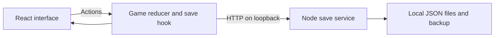

# Technical guide

[Overview and screenshots](../README.md) · [How to run](SETUP.md)

Little Room combines a React browser app, a central game reducer and a local
Node.js service. Progress lives in JSON files outside the repository. There is
no account system, database or cloud sync.

## Stack and deployment

| Layer | Implementation |
| --- | --- |
| Interface | React 18, JavaScript, CSS and illustrated raster assets |
| State and rules | React hooks and a central reducer |
| Charts | Derived session statistics rendered in the app |
| Sound | Procedural Web Audio |
| Local service | Node.js HTTP and filesystem APIs |
| Tooling | Create React App 5, Jest, React Testing Library, Node's test runner and Playwright |

In development, CRA serves the interface and proxies `/api` requests to the
save service. The launcher chooses distinct available ports, normally 3000
and 3001. In production, one Node service serves both `build/` and the API,
normally on port 3001. Services bind to `127.0.0.1`.



The service checks Host and Origin, caps request size and restricts static
paths to the build directory. It is designed for local desktop use and has
no authentication for an internet-facing deployment.

## Code map

| Area | Entry points |
| --- | --- |
| App composition and effects | [src/App.js](../src/App.js) |
| Timer, rewards, eggs, purchases and normalization | [src/domain/game.js](../src/domain/game.js) |
| Journal aggregation | [src/domain/analytics.js](../src/domain/analytics.js) |
| Feature UI | [src/features/](../src/features/) — timer, collection, room, journal and settings |
| Shared controls and surfaces | [src/shared/](../src/shared/) |
| Load, save, conflicts and drafts | [src/persistence/useLocalSave.js](../src/persistence/useLocalSave.js) |
| Synthesized audio | [src/audio/engine.js](../src/audio/engine.js) |
| HTTP routes and static serving | [server/index.cjs](../server/index.cjs) |
| File validation, revisions and atomic writes | [server/store.cjs](../server/store.cjs) |
| Startup and demo data | [scripts/dev.cjs](../scripts/dev.cjs), [scripts/demo.cjs](../scripts/demo.cjs) |
| Ordered global CSS | [src/styles/index.css](../src/styles/index.css) |

Feature components dispatch actions through the app. Saved state includes the
timer, settings, collection, room placement, notes and history. Panels,
selection, focus view and feedback are transient. Domain events are removed
from save snapshots so reloading does not replay a reward notice.

## Timer and progression

The timer separates `mode` (`focus`, `break`, `longBreak`), `status`
(`idle`, `running`, `paused`, `complete`) and focus `workMode`
(`pomodoro`, `countup`). Overtime stays part of the same focus session.

Time comes from timestamps and elapsed snapshots. The app dispatches `TICK`
every 250 ms and on visibility changes; accuracy does not depend on counting
ticks. Browser suspension can delay the display or sound.

- Countdown completion credits focus once. The app then starts the appropriate
  short or long break, unless the session was set to count overtime.
- Finishing count-up or overtime settles whole active minutes. History uses
  session IDs so the same focus is not rewarded twice.
- Sessions under one minute receive no history, gem or daily-goal credit.
- A new focus session captures its selected egg and pet bonus. Countdown allows
  two pauses of at most one minute; exceeding either limit forfeits session
  gems while keeping recorded time and egg progress.
- Break completion returns to focus and optionally starts it. Loading an
  expired break returns to idle focus rather than generating unattended sessions.

The reducer accepts explicit time and random-roll inputs for deterministic
tests. Journal totals are derived from history. Animation and sound do not
control reward settlement.

## Save lifecycle

| Request | Result |
| --- | --- |
| `GET /api/health` | Service availability |
| `GET /api/save` | `{state, revision, recovered, storagePath}` |
| `PUT /api/save` with `{state, revision}` | Save if the revision matches; return the new revision |

The save hook updates the UI immediately, debounces changes by 350 ms and keeps
one write in flight. Newer edits remain queued until that write finishes.
An empty profile returns `state: null` at revision 0; the app creates its starter
state. Load normalization handles legacy values and elapsed timers.

The store serializes operations, checks revisions, writes an exclusive temporary
file, syncs it and renames it into place. `state.backup.json` normally holds the
previous successful save; the first save also creates a backup. A valid backup
can restore an unreadable main file. If both are unreadable, they are preserved
and the service reports an error.

A stale revision returns HTTP 409. The app retains a recovery draft and blocks
game actions until the saved version is loaded. Connection failures retain
edits in the window and offer retry. Downloaded drafts are reference copies;
there is no automatic import or merge. See [backup and recovery](SETUP.md#backup-and-recovery).

Request bodies and serialized state are each limited to 1 MiB. The disk envelope
uses `formatVersion: 1`; game state separately uses `schemaVersion: 1` and
`progressionVersion: 2`. There is no interprocess lock: run only one service
per save folder.

## Development and checks

Use Node.js 22 or 24 LTS and install with `npm ci`. Keep domain rules in the
reducer, save scheduling in its hook, HTTP policy in the server and disk
operations in the store. Preserve save compatibility and the CSS import order.

```sh
npm run check
```

This runs syntax checks, frontend and server tests, a strict production build,
and startup/persistence smoke tests. For browser regressions:

```sh
npm run browsers:install
npm run validate
```

The browser suite covers Chromium, Firefox and WebKit. Headless checks do not
establish physical audio quality, screen-reader speech or mobile support.
CRA tooling has [reviewed dependency exceptions](DEPENDENCIES.md), which expire
and must be revisited; a passing gate does not imply zero advisories.

See [CONTRIBUTING.md](../CONTRIBUTING.md) for contributions. Dated publication
and acceptance evidence remains in [PUBLICATION_STATUS.md](PUBLICATION_STATUS.md).
