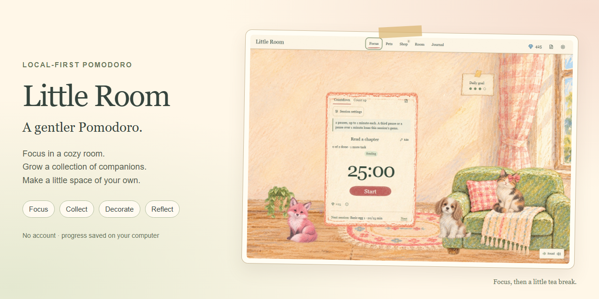

# Showcase media preparation

Publication Phase 6, October 9, 2026. See the [gallery](SHOWCASE.md) for screenshots
and a walkthrough transcript. Reviewed files are in `docs/media/`;
[manifest.json](media/manifest.json) records dimensions, hashes, source revision
and capture conditions.

## Capture and reproduce

Use Node.js 22 or 24 LTS. From the repository root:

```sh
npm ci
npm run browsers:install
npm run build:check
npm run showcase:capture
npm install --prefix .local/showcase/tools --no-save --ignore-scripts --no-audit --no-fund gifenc@1.0.3
npm run showcase:render
```

The capture launches the production service on an ephemeral loopback port,
creates a temporary save directory outside the repository, and uses fresh
Chromium contexts with [fictional data](../scripts/showcase-data.cjs). It never
reads the ordinary profile or reuses an existing browser tab. Once service startup
succeeds, capture cleanup stops it and removes its profile on success or failure.

The seven JPEGs use quality 90, 1440×1000 or 1440×1200 CSS viewports, device scale
1, `en-US` locale and UTC timezone. Their clock is fixed at October 9, 2026,
16:00 UTC; animations stop for a stable frame. The taller shop frame keeps Hatch
visible. Composition uses the fictional profile without restyling the app.

The walkthrough uses real elapsed time and a count-up session seeded with
65 seconds elapsed. Its hatch roll is fixed to produce a matching fox upgrade.
It records real controls and service responses, with captions around the app.
Playwright's installed FFmpeg encodes silent VP9 WebM at 15 fps and trims two
seconds of loading pre-roll. Encoding fails above 8 MB. The binary locator
follows the pinned Playwright 1.64 registry; recheck it when upgrading Playwright.
Browser installation supplies FFmpeg without a separate system install.

The renderer uses the room screenshot in the native HTML/CSS
[social-card template](../scripts/showcase/social-preview.html). It also makes
a six-frame GIF from captioned stills, with 3.5 seconds per frame. `gifenc 1.0.3`
is installed in ignored `.local/showcase/tools/`, not a project/runtime dependency.

Output goes to ignored `.local/showcase/capture/`: JPEGs, raw/compressed video,
preview frames, graphics and reports. For still iteration, run
`node scripts/showcase-capture.cjs --stills-only`. Run the full capture before
preparing a publication set so its video and manifest are current.

## Curate before committing

Inspect every screenshot at full size for readable content and visible controls.
Play and seek through the compressed video, compare chapters with the transcript,
and check GIF frames and loop duration. Review the social card at full and
thumbnail size. Keep content fictional and disclose seeded/controlled conditions.

Copy only the seven reviewed JPEGs, `walkthrough.webm`, `feature-tour.gif` and
`social-preview.png` into `docs/media/`. Rebuild the public manifest from
`capture.json`, `media-render.json` and inspected video metadata; verify byte
counts and SHA-256 and update captions/timings. Keep raw recordings, temporary
profiles and checker output local.

## Social preview



The PNG is **1280×640**, has a solid background and is **735,389 bytes**, meeting
[GitHub's recommended dimensions and under-1-MB requirement](https://docs.github.com/en/repositories/managing-your-repositorys-settings-and-features/customizing-your-repository/customizing-your-repositorys-social-media-preview).
The owner explicitly approved uploading this card during publication preparation.
It was applied under repository Settings → Social preview on October 24, 2026,
and verified after reloading that page. Artwork reuse terms remain unchanged.

## Verification and remaining gates

Capture revision identifiers below and in the manifest refer to the original
history at capture time. Phase 7 retains their corresponding commits in the
[commit map](history/COMMIT_MAP.json); use `npm run history:lookup -- 656cf33`
to resolve them. Original provenance and media bytes were not rewritten.

- Strict production build and all 22 server/launcher/policy tests passed on
  Windows with Node 22.14.0. App source and dependencies were unchanged;
  frontend suites were not repeated for media work.
- Canonical capture used clean checkpoint `656cf33`. Browser requests and page
  code reported zero errors. The walkthrough asserted completion, gem deduction,
  egg purchase, pet upgrade, room movement and an ambient setting.
- A follow-up capture from clean checkpoint `aed85fa` additionally asserted the
  exact typed note on disk and one-minute gem/egg credit. All assertions passed.
  The published media retain the reviewed `656cf33` capture and its transcript.
- Seven screenshots and the social card were visually reviewed. Compressed video
  decoded and played at 1360×1056 for approximately 39 seconds; chapter frames
  were inspected. The GIF decoded to six 3.5-second frames, looping in 21 seconds.
- The curated set is about 7.5 MB. Public manifest hashes match the files; raw
  evidence stays in `.local/phase6/`.

These captures do not close physical audio, phone, screen-reader, genuine zoom
or hosted CI gates. On October 24, the owner permitted running the app and
sharing its screenshots under the
[limited artwork permission](../ASSET_RIGHTS.md#limited-artwork-permission).
Other illustration reuse remains reserved. Current publication and release
status is in [PUBLICATION_STATUS.md](PUBLICATION_STATUS.md).
