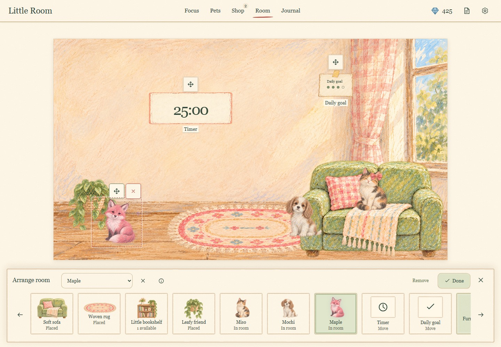
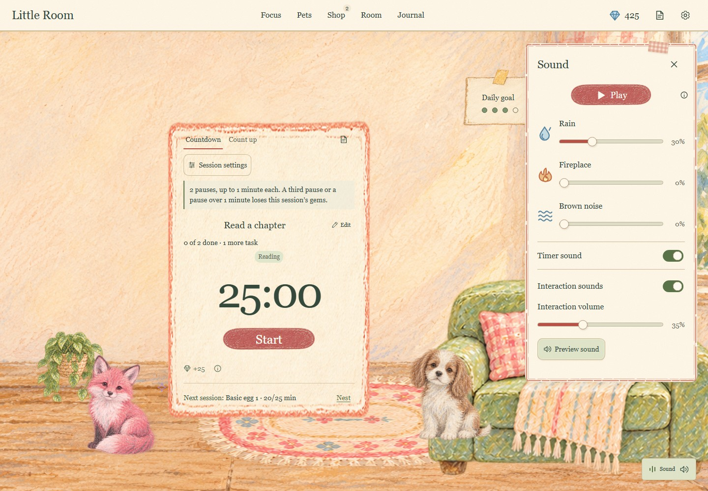

# A look inside Little Room

Focus in a cozy room, grow a collection, and keep a record of your work.
These are current production-app captures using a **fictional demo profile**.
The room is prepopulated with pets, eggs, points and sample sessions; a new
installation starts with its own starter room.

[Walkthrough](#walkthrough) · [Room](#your-room) · [Focus](#focus-and-notes)
· [Eggs](#eggs-and-hatching) · [Pets](#animal-companions)
· [Arrange](#room-arrangement) · [Journal](#focus-journal) · [Sound](#sound-and-atmosphere)

## Walkthrough

[**Download the captioned walkthrough**](media/walkthrough.webm) — 39 seconds,
WebM, about 3.3 MB. It is a silent recording of real app interactions; captions
sit outside the app. The sample count-up session starts with just over a minute
already elapsed, so finishing can show a whole-minute reward. The ready egg and
existing collection are seeded demo content.

| Approximate time | What you see |
| --- | --- |
| 00:00 | Capture a note during focus, pause, resume and finish the count-up session. Notes save without interrupting work. |
| 00:08 | Buy a basic egg, then hatch a ready rare egg. The matching fox upgrades the existing companion. |
| 00:16 | Open Pets and preview Miso's unlocked Hop animation. |
| 00:21 | Open Room → Arrange room, select Maple, nudge with an arrow key and choose Done. |
| 00:25 | Review seven-day Journal activity and open History to see the completed sample session. |
| 00:31 | Open Sound and adjust the rain level; that preference saves locally. |
| 00:35 | Return to the room with completed-session credit and the updated daily goal. |

The capture checks resulting saved notes, history, purchase balance, egg
inventory, pet upgrade, placement and sound preference. It does not establish
physical audio quality or broader device support.

Animated screenshot preview (21 seconds, six views)

This cycles through actual app stills. The WebM above is the interaction
recording; the gallery below provides the full static views.

## Your room

Choose countdown or count-up, keep tasks and tags beside the clock, and track
your daily session goal. Companions and furniture make the room your own.

## Focus and notes

Starting work enters a quiet view. Pause and intentional abandonment remain
available; the Scratchpad saves a thought without pausing the session.

## Eggs and hatching

Spend earned Shilligems on eggs, choose one to study with you, and hatch it
after enough credited focus. Rarity odds and hatch rules are available in the shop.

## Animal companions

Collect pets across four rarities. Matching duplicates unlock more animations;
owned accessories let you personalize a companion.

## Room arrangement

Place pets and furniture directly in the room. Drag or use arrow keys; the
horizontal library also includes the timer and daily goal.

## Focus Journal

Review focus minutes, sessions, active days, activity charts, tag totals and
task history. The seven-day sample below contains nine fictional sessions.

## Sound and atmosphere

Mix rain, fireplace and brown noise, and control timer alerts and interaction
feedback independently. Motion preferences are available in Settings.

## Under the hood

The React interface sends revision-checked saves to a local Node service; the
service keeps progress and a backup outside this repository. See the
[architecture diagrams](ARCHITECTURE.md) for deployment, state ownership and saving,
or [quick start](../README.md#quick-start) to try the app.

Capture method, provenance and reproduction commands are in
[media preparation](MEDIA.md). The illustrated assets are generated artwork;
their rights are documented separately in [ASSET_RIGHTS.md](../ASSET_RIGHTS.md).
Support limits and remaining acceptance checks remain in
[PROJECT.md](PROJECT.md#support-claims) and [release quality](RELEASE_QUALITY.md).
